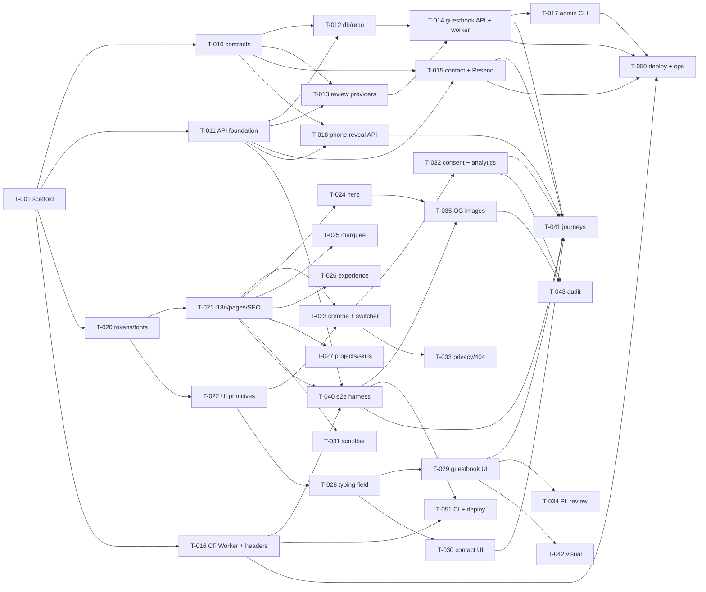

# Task backlog

Each task is a self-contained spec for one implementation agent. Process, roles, review, and Definition of Done: [`docs/agent-workflow.md`](../docs/agent-workflow.md). Template: [`_template.md`](_template.md). Reports go to `tasks/reports/T-xxx/`.

**Status is maintained only by the orchestrator** (`TODO` → `READY` → `IN_PROGRESS` → `IN_REVIEW` → `CHANGES_REQUESTED` → `APPROVED` → `DONE`; or `BLOCKED`).

All owner decisions that affect implementation are answered (see [`docs/decisions/open-questions.md`](../docs/decisions/open-questions.md)). Only the owner's go-live actions (D-23) remain, and they don't block any task.

## Index

| ID                                                 | Title                                                                      | Wave | Depends on                                      | Size | Status                                                                                  |
| -------------------------------------------------- | -------------------------------------------------------------------------- | ---- | ----------------------------------------------- | ---- | --------------------------------------------------------------------------------------- |
| [T-001](T-001-workspace-scaffold.md)               | Workspace scaffold and toolchain wiring                                    | 1    | none                                            | M    | DONE ([impl](reports/T-001/implementation-r1.md), [review](reports/T-001/review-r1.md)) |
| [T-010](T-010-contracts.md)                        | Shared API contracts, constants, validation rules                          | 2    | T-001                                           | M    | DONE ([impl](reports/T-010/implementation-r2.md), [review](reports/T-010/review-r2.md)) |
| [T-011](T-011-server-foundation.md)                | API foundation (config, logging, CORS, client IP, middleware)              | 2    | T-001                                           | L    | DONE ([impl](reports/T-011/implementation-r2.md), [review](reports/T-011/review-r2.md)) |
| [T-020](T-020-design-tokens-styles-fonts.md)       | Design tokens (approved contrast), styles, fonts, layout shell, showcase   | 2    | T-001                                           | M    | DONE ([impl](reports/T-020/implementation-r1.md), [review](reports/T-020/review-r1.md)) |
| [T-012](T-012-database-guestbook-repository.md)    | SQLite, migrations, newest-wins repository                                 | 3    | T-010, T-011                                    | M    | DONE ([impl](reports/T-012/implementation-r2.md), [review](reports/T-012/review-r2.md)) |
| [T-013](T-013-moderation.md)                       | Review providers: quality rules, blocked terms, moderation, suitability    | 3    | T-010, T-011                                    | L    | DONE ([impl](reports/T-013/implementation-r2.md), [review](reports/T-013/review-r2.md)) |
| [T-015](T-015-contact-api-mailer.md)               | Contact API + Resend mailer                                                | 3    | T-010, T-011                                    | M    | DONE ([impl](reports/T-015/implementation-r2.md), [review](reports/T-015/review-r2.md)) |
| [T-016](T-016-cloudflare-worker-locale-headers.md) | Cloudflare Worker (locale, `/set-language`), `_headers`, wrangler, preview | 3    | T-001                                           | M    | DONE ([impl](reports/T-016/implementation-r2.md), [review](reports/T-016/review-r2.md)) |
| [T-018](T-018-phone-reveal-api.md)                 | Phone reveal API (Turnstile verification)                                  | 3    | T-010, T-011                                    | S    | DONE ([impl](reports/T-018/implementation-r2.md), [review](reports/T-018/review-r2.md)) |
| [T-021](T-021-i18n-pages-seo-composition.md)       | i18n, pages, SEO, CSP, composition stubs, API client                       | 3    | T-020                                           | L    | DONE ([impl](reports/T-021/implementation-r2.md), [review](reports/T-021/review-r2.md)) |
| [T-022](T-022-ui-primitives-decor.md)              | UI primitives and decor                                                    | 3    | T-020                                           | M    | DONE ([impl](reports/T-022/implementation-r2.md), [review](reports/T-022/review-r1.md)) |
| [T-014](T-014-guestbook-service-worker-api.md)     | Guestbook service, review pipeline, newest-wins worker, API                | 4    | T-012, T-013                                    | L    | DONE ([impl](reports/T-014/implementation-r2.md), [review](reports/T-014/review-r2.md)) |
| [T-023](T-023-site-chrome.md)                      | Header, nav, mobile menu, aside, footer, language switcher                 | 4    | T-021, T-022                                    | L    | DONE ([impl](reports/T-023/implementation-r2.md), [review](reports/T-023/review-r2.md)) |
| [T-024](T-024-hero-mascot-decor-layer.md)          | Hero, mascot, drips layer                                                  | 4    | T-021, T-022                                    | M    | DONE ([impl](reports/T-024/implementation-r2.md), [review](reports/T-024/review-r2.md)) |
| [T-025](T-025-marquee-bands.md)                    | Marquee bands                                                              | 4    | T-021, T-022                                    | S    | DONE ([impl](reports/T-025/implementation-r2.md), [review](reports/T-025/review-r2.md)) |
| [T-026](T-026-experience-timeline.md)              | Experience sticky timeline                                                 | 4    | T-021, T-022                                    | L    | IN_PROGRESS                                                                             |
| [T-027](T-027-projects-skills.md)                  | Projects and Skills sections                                               | 4    | T-021, T-022                                    | S    | IN_REVIEW                                                                               |
| [T-028](T-028-typing-field.md)                     | Animated typing field                                                      | 4    | T-020, T-022                                    | M    | IN_REVIEW                                                                               |
| [T-031](T-031-custom-scrollbar.md)                 | Custom scrollbar                                                           | 4    | T-021                                           | S    | IN_PROGRESS                                                                             |
| [T-040](T-040-e2e-a11y-harness.md)                 | E2E + a11y harness (wrangler dev + API)                                    | 4    | T-011, T-016, T-021                             | M    | READY                                                                                   |
| [T-017](T-017-guestbook-admin-cli.md)              | Guestbook admin CLI (archive list/export, takedown)                        | 5    | T-014                                           | S    | IN_REVIEW                                                                               |
| [T-029](T-029-guestbook-ui.md)                     | Guestbook UI (loading/empty/error states) + client                         | 5    | T-010, T-021, T-022, T-028                      | L    | TODO                                                                                    |
| [T-030](T-030-contact-ui.md)                       | Contact UI + client                                                        | 5    | T-010, T-021, T-022, T-028                      | L    | TODO                                                                                    |
| [T-032](T-032-cookie-consent-analytics.md)         | Cookie consent + GA4 + PostHog (cookieless on reject)                      | 5    | T-021, T-022, T-023                             | L    | TODO                                                                                    |
| [T-033](T-033-privacy-and-404-pages.md)            | Privacy policy and 404 pages                                               | 5    | T-021, T-023                                    | M    | TODO                                                                                    |
| [T-035](T-035-og-images.md)                        | Generated OG images (EN/PL)                                                | 5    | T-020, T-021, T-024, T-040                      | S    | TODO                                                                                    |
| [T-051](T-051-ci-pipeline.md)                      | CI + site deploy workflow                                                  | 5    | T-016, T-040                                    | M    | TODO                                                                                    |
| [T-034](T-034-polish-copy-review.md)               | Polish copy review pack (owner gate at the end)                            | 6    | all copy tasks                                  | M    | TODO                                                                                    |
| [T-041](T-041-e2e-critical-journeys.md)            | E2E critical journeys                                                      | 6    | T-014, T-015, T-023, T-029, T-030, T-032, T-040 | L    | TODO                                                                                    |
| [T-042](T-042-visual-fidelity-baselines.md)        | Visual fidelity pass + baselines                                           | 6    | all UI tasks, T-040                             | L    | TODO                                                                                    |
| [T-043](T-043-performance-seo-a11y-audit.md)       | Performance, SEO, a11y audit + release checks                              | 6    | all UI tasks, T-032, T-035                      | M    | TODO                                                                                    |
| [T-050](T-050-container-operations.md)             | API container, Railway + Cloudflare deployment, runbook                    | 6    | T-014, T-015, T-016, T-017                      | L    | TODO                                                                                    |

32 tasks.

## Known issues and follow-ups

| Source                    | Item                                                                                                                                                                                                                                                | Owner                                        |
| ------------------------- | --------------------------------------------------------------------------------------------------------------------------------------------------------------------------------------------------------------------------------------------------- | -------------------------------------------- |
| T-001 review note 2       | Root peer warning: `eslint-plugin-jsx-a11y@6.10.2` declares eslint ≤ 9 while the root uses `eslint@10.13.0`. Linting works; **don't change versions** without an orchestrator decision                                                              | orchestrator (track upstream)                |
| T-011 review R2-01        | `error-handler.ts` maps any thrown 4xx `status` to 400 `INVALID_JSON`; restrict to body-parser errors                                                                                                                                               | T-018 (amendment)                            |
| T-010 review R2-01, R2-02 | `EMAIL` regex is O(n²) (safe only because of the 480-char cap); invisible/look-alike link evasions                                                                                                                                                  | follow-up (moderation is the backstop)       |
| T-010 review R2-03        | Use `checkGuestbookBody` only                                                                                                                                                                                                                       | T-014, T-029 (notes added)                   |
| Orchestrator 2026-10-25   | A stray `node_modules` above the repo (v5 `@typescript-eslint/parser`) was picked up by `eslint-plugin-astro` user-local lookup and crashed ESLint on `.astro`. Fixed by declaring `@typescript-eslint/parser` at the root                          | done                                         |
| T-013 review R1 notes     | Contracts guestbook rules allow soft hyphens and combining-mark floods (moderation layers are the backstop); `respond.ts` keeps a local `ApiErrorCode` mirror (T-011 leftover); move `infra/review/test-kit.ts` to `src/test-support/`              | follow-up (T-014 may take the test-kit move) |
| T-016 review              | Confirm emulator assumptions on real workerd: `_headers` on `ASSETS.fetch` responses, `/index.html` → `/` redirect, html-handling redirects are 307 and whether `_headers` applies to redirects/404s, non-GET to assets, `/pl/nope` → `pl/404.html` | T-051                                        |
| T-001 review note 3       | `apps/web/tsconfig.json` has a narrow `include`; tasks adding TS files at the web root (`integrations/*.ts`, `security-headers.ts`) must extend it                                                                                                  | T-016, T-020                                 |

## Dependency graph

## Waves and parallelization

| Wave | Run in parallel                                                            | Conflict guards                                                                                                                                                                                                                                                             |
| ---- | -------------------------------------------------------------------------- | --------------------------------------------------------------------------------------------------------------------------------------------------------------------------------------------------------------------------------------------------------------------------- |
| 1    | T-001                                                                      | Gate for everything.                                                                                                                                                                                                                                                        |
| 2    | T-010 ∥ T-011 ∥ T-020                                                      | Disjoint directories.                                                                                                                                                                                                                                                       |
| 3    | T-012 ∥ T-013 ∥ T-015 ∥ T-016 ∥ T-018 ∥ T-021 ∥ T-022                      | Server tasks each add one wiring line to `main.ts`; **merge them one at a time**. T-016 and T-021 both touch `astro.config.ts` (T-016: register the integration only; T-021: i18n, sitemap, CSP); merge T-021 first, then rebase T-016. T-022 only appends to the showcase. |
| 4    | T-014 ∥ T-023 ∥ T-024 ∥ T-025 ∥ T-026 ∥ T-027 ∥ T-028 ∥ T-031 ∥ T-040      | Frontend tasks own their stub files + message/content modules. T-022/T-023/T-028 showcase appends merge sequentially.                                                                                                                                                       |
| 5    | T-017 ∥ T-029 ∥ T-030 ∥ T-032 ∥ T-033 ∥ T-035 ∥ T-051                      | T-032's CSP change to `astro.config.ts` goes through a Change Request (shared surface).                                                                                                                                                                                     |
| 6    | T-041 ∥ T-043 ∥ T-050 ∥ T-034; then T-042 alone (touches component styles) | T-034 has an owner gate at the very end (D-02).                                                                                                                                                                                                                             |

**Critical path:** T-001 → T-020 → T-021 → T-023 → T-032 → T-041/T-043, in parallel with T-001 → T-011 → T-012/T-013 → T-014 → T-041. About 6 waves with 3–4 concurrent agents.

## Requirement coverage

| Requirement                                                            | Tasks                                                 |
| ---------------------------------------------------------------------- | ----------------------------------------------------- |
| FR-01 page structure                                                   | T-021, T-023…T-030                                    |
| FR-02 routes · FR-03 negotiation · FR-04 switcher · FR-05 localization | T-016, T-021, T-023, T-033, T-034                     |
| FR-10…FR-13 chrome                                                     | T-023                                                 |
| FR-14 decor · FR-20 hero                                               | T-024                                                 |
| FR-15 scrollbar                                                        | T-031                                                 |
| FR-16 consent + analytics                                              | T-032                                                 |
| FR-21 marquee · FR-22 experience · FR-23/24 projects/skills            | T-025 · T-026 · T-027                                 |
| FR-25…FR-27 guestbook UI (incl. loading/empty/error)                   | T-028, T-029                                          |
| FR-28/29 contact UI                                                    | T-028, T-030                                          |
| FR-40…FR-46 guestbook backend (newest-wins, layered review, retention) | T-010, T-012, T-013, T-014                            |
| FR-47 contact backend (Resend)                                         | T-015                                                 |
| FR-48 admin CLI + private archive                                      | T-012, T-017                                          |
| FR-49 health                                                           | T-011                                                 |
| FR-50 phone reveal (Turnstile)                                         | T-018, T-030, T-041                                   |
| NFR-01 fidelity                                                        | every UI task, T-042                                  |
| NFR-02 accessibility                                                   | every UI task, T-040, T-041, T-043                    |
| NFR-03 performance · NFR-04 SEO (incl. OG images)                      | T-020, T-021, T-032, T-035, T-043                     |
| NFR-05 security                                                        | T-011, T-013…T-016, T-021, T-029, T-030, T-040, T-041 |
| NFR-06 privacy                                                         | T-011, T-014, T-015, T-032, T-033                     |
| NFR-07 reliability                                                     | T-011, T-012, T-014, T-050                            |
| NFR-08/09 maintainability, testability                                 | all; T-001, T-040, T-051                              |
| NFR-10 browsers                                                        | T-040, T-041                                          |
| NFR-11 operability                                                     | T-011, T-017, T-050, T-051                            |
| NFR-12 cost                                                            | T-013, T-014 (caps), T-015, T-050                     |
| NFR-13 no-JS                                                           | T-016 (switcher), T-023, T-026, T-029, T-030, T-041   |
